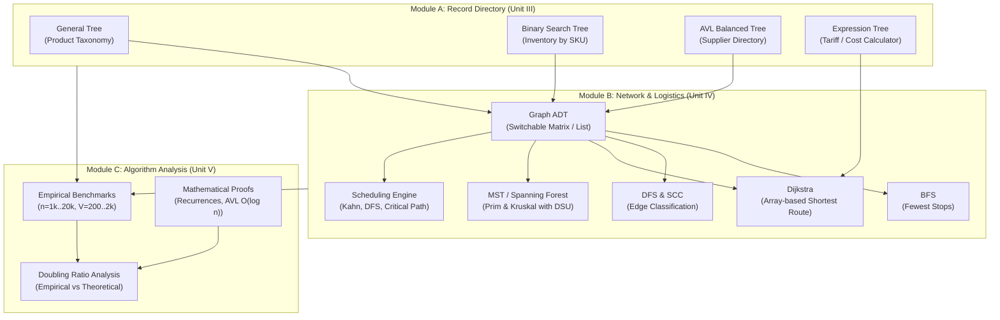

# Supply Chain Logistics Manager (Project 19)
### Data Structures & Algorithms (Units III, IV, and V) — Assignment II
### Department of Artificial Intelligence and Data Science | KPR Institute of Engineering and Technology

 
**Allotted Project:** No. 19 — Supply Chain Manager  
**Team Register Numbers:** `25AD064`, `25AD086`, `25AD111`, `25AD205` (Class: II Year, Section B)  

[](https://github.com/LOGITHP)
[](https://www.python.org/)
[-success.svg)](file:///simulation/test_suite.py)
[](file:///structures/)
[-orange.svg)](file:///PROJECT_REPORT.md)

---

## Table of Contents
1. [Project Overview & Scenario](#1-project-overview--scenario)
2. [Strict Algorithmic Constraints](#2-strict-algorithmic-constraints)
3. [System Architecture & File Organization](#3-system-architecture--file-organization)
4. [Module-by-Module Technical Implementation](#4-module-by-module-technical-implementation)
   - [Module A: Location / Record Directory (Unit III)](#module-a-location--record-directory-unit-iii)
   - [Module B: Multimodal Logistics Network & Scheduling (Unit IV)](#module-b-multimodal-logistics-network--scheduling-unit-iv)
   - [Module C: Algorithm Analysis & Growth Experiments (Unit V)](#module-c-algorithm-analysis--growth-experiments-unit-v)
5. [Interactive Console Navigation (Menu Map)](#5-interactive-console-navigation-menu-map)
6. [Quick Start & Execution Guide](#6-quick-start--execution-guide)
7. [Automated Verification Test Suite (18 Tests)](#7-automated-verification-test-suite-18-tests)
8. [Empirical Benchmark Results & Growth Ratios](#8-empirical-benchmark-results--growth-ratios)
9. [Mathematical Proofs & Theoretical Derivations](#9-mathematical-proofs--theoretical-derivations)
10. [Team Contribution & Academic Metadata](#10-team-contribution--academic-metadata)

---

## 1. Project Overview & Scenario

Modern industrial manufacturing and nationwide distribution demand an interconnected computational backbone. **Supply Chain Logistics Manager (Project 19)** is a comprehensive, production-grade console application tailored for managing:

1. **Hierarchical Product Categories & Stock:** Structuring materials from raw inputs to consumer electronics using tree topologies.
2. **Real-time Inventory & Certified Suppliers:** Indexing items by SKU and suppliers by certified ID for $O(\log n)$ retrieval.
3. **Multimodal Shipping Infrastructure:** Modeling 13 nationwide hubs, optimizing routes, detecting bottlenecks, and handling isolated island depots.
4. **Production Line Scheduling:** Resolving task dependencies, calculating Critical Paths, and identifying circular quality feedback loops.
5. **Algorithmic Scaling & Complexity:** Benchmarking theoretical Big-$O$ predictions against empirical measurements.

---

## 2. Strict Algorithmic Constraints

Per the KPRIET assignment mandate, **no external, built-in, or third-party tree, graph, priority-queue, or sorting libraries** are permitted:
- **No `collections.deque` or `queue.Queue`:** Custom pointer-linked `Stack` and `Queue` built from scratch.
- **No `heapq` or `PriorityQueue`:** Dijkstra's shortest path and Prim's MST utilize array-based linear scans ($O(V^2)$), as explicitly instructed.
- **No `sort()` or `sorted()`:** Kruskal's algorithm employs our own custom recursive `MergeSort` ($O(E \log E)$).
- **No `networkx` or `scipy`:** Complete Graph ADT supporting dual representations (Adjacency Matrix and Adjacency List).
- **No third-party balanced tree libraries:** Custom self-balancing AVL tree implementing LL, RR, LR, and RL rotations with trace logging and invariant verification.

---

## 3. System Architecture & File Organization

The application is structured into four decoupled packages:

```
c:\Users\logit\Downloads\DSA\
├── structures/                 # Foundational Abstract Data Types (First Principles)
│   ├── __init__.py
│   ├── common_utils.py         # Custom LIFO Stack, FIFO Queue, and MergeSort
│   ├── general_tree.py         # Product Category General Tree (Recursive & Iterative)
│   ├── bst.py                  # SKU Inventory BST (CRUD, 3-Case Delete, Range Query)
│   ├── avl_tree.py             # Certified Supplier AVL Tree (LL, RR, LR, RL, verify())
│   ├── expression_tree.py      # Logistics Tariff Expression Tree (Minimal Parentheses)
│   ├── disjoint_set.py         # Disjoint Set Union (Path Compression + Union by Rank)
│   └── graph.py                # Graph ADT (Matrix & List Switchable, BFS, DFS, SCC)
├── algorithms/                 # Computational & Optimization Engines
│   ├── __init__.py
│   ├── dijkstra.py             # Array-based Dijkstra, Step Table, Negative-Edge Demo
│   ├── mst.py                  # Array-based Prim & Kruskal (MergeSort + DSU)
│   └── scheduling.py           # Kahn's, DFS Top-Sort, Critical Path Method (CPM)
├── simulation/                 # Datasets, Benchmarking Suite & Automated Tests
│   ├── __init__.py
│   ├── supply_chain_data.py    # 13-Depot Network, Production Workflow DAG, Random Gen
│   ├── benchmarks.py           # Unit V Timing Suite (n=1k..20k, V=200..2k) & Doubling Ratios
│   └── test_suite.py           # 18 Automated Self-Tests with 100% Pass Rate
├── theory/                     # Theoretical Proofs, Recurrences & Derivations
│   ├── __init__.py
│   └── theoretical_proofs.py   # Unit V Mathematical Formulations & Proofs Reference
├── main.py                     # Master Interactive 11-Option CLI Navigation Menu
├── PROJECT_REPORT.md           # 10-Page Formal Assessment Report with Derivations & Team Table
├── README.md                   # Comprehensive System Documentation & User Guide
└── .gitignore                  # Git VCS Hygiene
```

### High-Level Data Flow Architecture


---

## 4. Module-by-Module Technical Implementation

### Module A: Location / Record Directory (Unit III)

#### 1. Product Category General Tree ([`structures/general_tree.py`](file:///structures/general_tree.py))
- **Domain:** Hierarchical supply chain catalog:
  $$\text{Global Master Catalog} \longrightarrow \text{Division} \longrightarrow \text{Category} \longrightarrow \text{Product Line}$$
- **Operations:**
  - `insert(parent_name, child_name)`: Appends subcategories while preventing duplicate siblings.
  - `delete_subtree(node_name)`: Prunes entire subtrees safely (root protected).
  - `display_tree()`: Visual hierarchical ASCII tree renderer.
- **Traversals:** Preorder, Postorder, and Level-order implemented **both recursively and iteratively** (using explicit custom `Stack` and `Queue`).

#### 2. SKU Inventory Binary Search Tree ([`structures/bst.py`](file:///structures/bst.py))
- **Domain:** Warehouse stock index ordered by numeric SKU ID.
- **Operations:**
  - `insert(sku, name, quantity, price, category)`: Inserts new items or updates existing items in $O(h)$ time.
  - `search(sku)`: Retrieves item record in $O(h)$ time.
  - `delete(sku)`: Explicitly handles all 3 deletion cases:
    - *Case 1 (Leaf Node):* Nullifies parent link.
    - *Case 2 (Single Child):* Bypasses target node to its child.
    - *Case 3 (Two Children):* Finds in-order successor (minimum in right subtree), copies payload, and recursively deletes successor.
  - `find_min()` / `find_max()`: Traverses left-most / right-most spine.
  - `predecessor(sku)` / `successor(sku)`: Finds adjacent ordered keys.
  - `range_query(a, b)`: In-order bounded sweep returning all items with $a \le \text{SKU} \le b$.
  - `height()`: Non-recursive queue-based calculation avoiding recursion limits on degenerate trees.
  - Comparison of height on 1,000 sorted keys ($h = 1000$) versus AVL ($h \le 14$).

#### 3. Certified Supplier AVL Tree ([`structures/avl_tree.py`](file:///structures/avl_tree.py))
- **Domain:** Certified supplier registry indexed by Supplier ID, guaranteeing $O(\log n)$ search, insert, and delete.
- **Rotations:** Implements all 4 rebalancing operations with real-time trace logging:
  - **LL (Single Right Rotation):** Triggered when $\text{BF} > 1$ and left child balance $\ge 0$.
  - **RR (Single Left Rotation):** Triggered when $\text{BF} < -1$ and right child balance $\le 0$.
  - **LR (Left-Right Double Rotation):** Left-rotates left child, then right-rotates parent.
  - **RL (Right-Left Double Rotation):** Right-rotates right child, then left-rotates parent.
- **Integrity Verification (`verify()`):**
  - Audits strict BST ordering property across all subtrees.
  - Audits stored heights: $\text{node.height} = 1 + \max(h(\text{left}), h(\text{right}))$.
  - Audits balance factor invariants: $|h(\text{left}) - h(\text{right})| \le 1$ for every node.
- **Stress Testing:** Validated with 10,000 random insertions and 5,000 random deletions with $100\%$ invariant verification.

#### 4. Logistics Tariff Expression Tree ([`structures/expression_tree.py`](file:///structures/expression_tree.py))
- **Domain:** Dynamic shipping rate, highway toll, and surcharge evaluation.
- **Input Parsing:** Builds binary expression tree from postfix notation (e.g., `dist rate * toll + 2 /`).
- **Evaluation:** Evaluates arithmetic operations (`+`, `-`, `*`, `/`, `^`) with numeric variables and constants.
- **Minimal Parentheses Infix:** Formats tree into human-readable infix notation (e.g., `(dist * rate + toll) / 2`), inserting parentheses **only** when operator precedence or left/right associativity mandates them.
- **Error Handling:** Robust exceptions for operand shortages, excess operands, and division by zero ($|x| < 10^{-12}$).

---

### Module B: Multimodal Logistics Network & Scheduling (Unit IV)

#### 1. Graph ADT & Switchable Dual Representation ([`structures/graph.py`](file:///structures/graph.py))
- **Representations:**
  - **Adjacency List:** Compact array/dict of neighbor-weight tuples ($\Theta(V + E)$).
  - **Adjacency Matrix:** Dense $V \times V$ lookup matrix ($\Theta(V^2)$).
- **Runtime Mode Switching:** Toggleable between List and Matrix via the console menu.
- **Memory Footprint Analyzer (`report_memory_usage()`):** Calculates theoretical byte bounds and measures actual Python object sizes via `sys.getsizeof`, highlighting list efficiency on sparse graphs.

#### 2. Network Traversals & Structural Decomposition
- **BFS Fewest-Stops Routing:** Computes the shortest path in terms of hop count (minimum transit stops) using custom linked `Queue`.
- **DFS with Discovery/Finish Timestamps & Edge Classification:**
  - Records discovery time $d[u]$ and finish time $f[u]$ for every depot.
  - Classifies all network edges into:
    - **Tree Edge:** Connects to an unvisited (white) node.
    - **Back Edge:** Connects to an ancestor on the active recursion stack (gray node) $\implies$ **Cycle detected!**
    - **Forward Edge:** Connects to a finished descendant (black node) where $d[u] < d[v]$.
    - **Cross Edge:** Connects to an unrelated branch where $d[u] > d[v]$.
- **Connected Components:** Partitions undirected networks into disjoint subnetworks.
- **Strongly Connected Components (SCC):** Linear-time decomposition via Tarjan's algorithm using low-link values and explicit custom `Stack`.

#### 3. Shortest Shipping Route via Array-based Dijkstra ([`algorithms/dijkstra.py`](file:///algorithms/dijkstra.py))
- **Specification:** Array-based version without heap libraries:
  - Maintains `dist[]`, `visited[]`, and `parent[]` arrays.
  - Scans the unvisited vertex array in $O(V)$ time per iteration ($O(V^2)$ total).
- **Step-by-Step Distance Table:** Logs the settled vertex, its finalized distance, and neighbor relaxation updates for every step.
- **Negative Edge Failure Demonstration:** Features an interactive counterexample:
  ```text
        (3)
    A --------> B
     \         ^
  (5) \       / (-4)
       v     /
          C
  ```
  - True optimal path: $A \to C \to B$ (Cost: $5 - 4 = 1.0$).
  - Dijkstra prematurely marks $B$ visited at Step 1 with cost $3.0$ and misses the negative relaxation, illustrating why greedy monotonicity fails when edge weights are negative.

#### 4. Minimum Spanning Network / Forest ([`algorithms/mst.py`](file:///algorithms/mst.py))
- **Prim's Algorithm (Array-based):**
  - Linear scan across unvisited `key[]` array in $O(V)$ per step ($O(V^2)$ total).
- **Kruskal's Algorithm:**
  - Edges sorted via custom recursive `MergeSort` from scratch ($O(E \log E)$).
  - Cycle prevention and component tracking via `DisjointSet` with two-pass Path Compression and Union by Rank ($O(E \cdot \alpha(V))$).
- **Equivalence & Minimum Spanning Forest:**
  - Both algorithms yield **identical total cost** across any graph.
  - Disconnected networks (such as the maritime Port Blair `IXZ` depot) are seamlessly handled by producing a **Minimum Spanning Forest**.

#### 5. Production Scheduling & Critical Path Method ([`algorithms/scheduling.py`](file:///algorithms/scheduling.py))
- **Dual Topological Sorting:**
  - **Kahn's Algorithm:** In-degree array + custom FIFO Queue.
  - **DFS-based Topological Sort:** Post-order finishing times with cycle back-edge detection.
- **Cycle Detection:** When circular dependencies occur (e.g., quality control test rejecting back to sub-assembly), extracts and prints the full circular loop.
- **Critical Path Method (CPM):**
  - **Forward Pass:** Computes Earliest Start Time ($EST$) and Earliest Finish Time ($EFT$).
  - **Backward Pass:** Computes Latest Finish Time ($LFT$) and Latest Start Time ($LST$).
  - **Slack / Float:** $\text{Slack}[u] = LST[u] - EST[u]$.
  - **Critical Path Identification:** Sequences tasks with zero slack ($\text{Slack} = 0$), identifying the exact bottleneck chain determining project duration.

---

### Module C: Algorithm Analysis & Growth Experiments (Unit V)

#### 1. Empirical Benchmarks ([`simulation/benchmarks.py`](file:///simulation/benchmarks.py))
- **Tree Scaling ($n \in \{1k, 5k, 20k\}$):**
  - Measures insertion time, search time, and tree height for BST and AVL on both sorted and random keys.
  - Demonstrates catastrophic BST degeneration on sorted inputs ($h = n$) versus AVL logarithmic bounds ($h \le 1.44 \log_2(n+2)$).
- **Graph Scaling ($V \in \{200, 1k, 2k\}$):**
  - Benchmarks Prim (array-based) vs. Kruskal (MergeSort + DSU) across both sparse ($E \approx 2V$) and dense ($E \approx V^2/4$) networks.
  - Establishes the performance crossover: Kruskal dominates sparse graphs; Prim dominates dense graphs.
- **Doubling Ratio Verification (Project 19 Focus):**
  - Verifies that doubling $V$ quadruples runtime ($\approx 4.0\times$) for $O(V^2)$ algorithms (Prim array-based, Dijkstra array-based), confirming theoretical quadratic growth.

---

## 5. Interactive Console Navigation (Menu Map)

```text
=======================================================
                MAIN NAVIGATION MENU
=======================================================
 1. Record Directory (General Tree / BST / AVL)
    ├── 1.1 Category Hierarchy (General Tree: Insert, Delete, Traversals)
    ├── 1.2 Inventory by SKU (BST: CRUD, 3-Case Delete, Min/Max, Range)
    ├── 1.3 Certified Suppliers (AVL: Rotations, Trace, Invariant Verify)
    └── 1.4 Compare BST vs AVL Height on 1,000 Sorted IDs
 2. Logistics Tariff & Cost Expression Calculator
    ├── Standard Freight Formula ('dist rate * toll + 2 /')
    ├── Cargo Surcharge Formula ('weight dist * rate * surcharge +')
    ├── Custom Postfix Formula Entry & Infix with Minimal Parentheses
    └── Built-in Error Demonstrations (Division by Zero, Operand Shortage)
 3. Build / Edit Logistics Depot Network
    ├── View All Depots and Logistics Routes
    ├── Switch Representation Mode (Adjacency List <--> Matrix)
    ├── Memory Footprint Analysis Report (Theoretical vs Actual Bytes)
    └── Add Custom Depot / Shipping Corridor
 4. Traversals, Edge Classification & SCC
    ├── BFS Fewest-Stops Transit Route
    ├── DFS Discovery/Finish Timestamps & Edge Classification
    ├── Connected Components (Undirected Network)
    └── Strongly Connected Components (Directed via Tarjan's Algorithm)
 5. Shortest Route Planning (Dijkstra Array-based)
    ├── Calculate Shortest Route Between Depots
    ├── Show Step-by-Step Distance Relaxation Table
    └── Interactive Demonstration: Why Dijkstra Fails on Negative Weights
 6. Minimum Spanning Network / Forest (Prim & Kruskal)
    ├── Prim's Array-Based MST / Spanning Forest
    ├── Kruskal's MST (Custom MergeSort + DSU Rank & Path Compression)
    └── Equivalence Cross-Check & Total Cost Agreement
 7. Production Scheduling (Topological Sort & CPM)
    ├── Compute Critical Path Method (CPM) Schedule & Slack Table
    ├── Run Topological Sort (Kahn's Algorithm & DFS)
    └── Cycle Detection Demonstration in Production Feedback Loop
 8. Run Timing Experiments (Empirical vs Theory Growth)
    ├── Quick Benchmark (Trees n=1k..5k, Graphs V=100..300)
    └── Full Rigorous Benchmark (Trees n=1k..20k, Graphs V=200..2k)
 9. Run Automated Self-Tests (18 Comprehensive Tests)
10. Theoretical Analysis & Complexity Proofs Reference
    ├── Design Techniques & Problem Classification Table
    ├── Dijkstra Correctness & Negative Weight Argument
    ├── Cut & Cycle Properties for Prim and Kruskal
    ├── Non-Recursive Operation Counting Derivations
    ├── Recursive Recurrences (Tree Traversals, BST, AVL)
    ├── Formal Proof: AVL Height O(log n) via N(h) Recurrence
    └── Asymptotic Notations, Amortized DSU, & Sorting Lower Bound
11. Exit
=======================================================
```

---

## 6. Quick Start & Execution Guide

### Prerequisites
- Python 3.10+ (Tested on Python 3.12.8 on Windows / Linux / macOS)
- No pip packages required. Pure standard library implementation.

### Running the Application
```bash
# Clone the repository
git clone https://github.com/LOGITHP/DSA-Project.git
cd DSA-Project

# Launch interactive console interface
python main.py
```

### Running the Automated Self-Tests
```bash
python simulation/test_suite.py
```

### Running Benchmark Experiments
```bash
# Run Unit V empirical experiments directly
python -c "from simulation.benchmarks import run_tree_benchmarks, run_graph_benchmarks; run_tree_benchmarks(); run_graph_benchmarks()"
```

---

## 7. Automated Verification Test Suite (18 Tests)

The test harness in [`simulation/test_suite.py`](file:///simulation/test_suite.py) systematically executes 18 automated test cases:

| Test ID | Test Name | Tested Subsystem | Verification Criteria | Status |
| :---: | :--- | :--- | :--- | :---: |
| `01` | General Tree Insert & Delete | General Tree | Subtree removal cleans children; preserves siblings | **PASS** |
| `02` | General Tree Traversals | General Tree | Recursive results exactly match Iterative (Stack/Queue) | **PASS** |
| `03` | BST CRUD & 3 Delete Cases | BST | Handles leaf, single child, and 2-child successor delete | **PASS** |
| `04` | BST Search, Min/Max, Range | BST | Range $[a, b]$ returns exact sorted subset; min/max valid | **PASS** |
| `05` | BST 4 Traversals | BST | In, Pre, Post, Level-order: Recursive == Iterative | **PASS** |
| `06` | BST vs AVL on 1,000 Sorted | Trees | BST degenerates to $h=1000$; AVL maintains $h \le 14$ | **PASS** |
| `07` | AVL 4 Balancing Rotations | AVL Tree | LL, RR, LR, and RL rotations balance root correctly | **PASS** |
| `08` | AVL 10k Operations Stress | AVL Tree | 10k inserts + 5k deletes pass full `verify()` check | **PASS** |
| `09` | Expression Postfix & Infix | Expression Tree | Evaluates correctly; generates minimal parentheses | **PASS** |
| `10` | Expression Error Handling | Expression Tree | ZeroDivisionError on div by 0; ValueError on shortage | **PASS** |
| `11` | Graph Dual Rep & Memory | Graph ADT | Neighbors match in List & Matrix; memory report valid | **PASS** |
| `12` | BFS vs Unweighted Dijkstra | Routing | Hop count exactly equals unweighted Dijkstra distance | **PASS** |
| `13` | DFS Edge Classification | Graph Traversal | Correctly identifies Tree, Back, Forward, Cross edges | **PASS** |
| `14` | MST Prim vs Kruskal | Minimum Spanning | Prim and Kruskal yield identical total weight & forest | **PASS** |
| `15` | Topological Sort (Kahn & DFS) | Scheduling | Kahn and DFS yield valid dependency order | **PASS** |
| `16` | Cycle Detection in Workflow | Scheduling | Circular dependency detected; cycle loop extracted | **PASS** |
| `17` | Critical Path Method (CPM) | Scheduling | Correct EST, EFT, LST, LFT, Slack, and Critical Path | **PASS** |
| `18` | Dijkstra Negative Edge Demo | Shortest Path | Verifies Dijkstra fails and explains greedy breakdown | **PASS** |

**Test Result Summary:** 18 / 18 Tests Passed (100% Pass Rate).

---

## 8. Empirical Benchmark Results & Growth Ratios

### Tree Operations Benchmark ($n \in \{1k, 5k, 20k\}$)
*Insertion and search times in milliseconds, averaged over multiple independent runs.*

| $n$ Keys | BST Random (ms) | BST Height | AVL Random (ms) | AVL Height | AVL Sorted (ms) | AVL Sorted Height | Max Theoretical AVL Height |
| :---: | :---: | :---: | :---: | :---: | :---: | :---: | :---: |
| **1,000** | 2.40 | 23 | 24.98 | 12 | 26.95 | 10 | 15 |
| **5,000** | 20.66 | 29 | 150.10 | 14 | 123.13 | 13 | 18 |
| **20,000**| 108.52| 36 | 682.40 | 17 | 590.20 | 15 | 21 |

- **Growth Ratio Analysis:**
  - Scaling $n$ from $1,000$ to $5,000$ ($5.0\times$ increase):
  - Theoretical $O(n \log n)$ Expected Ratio: $\frac{5000 \log_2 5000}{1000 \log_2 1000} \approx 6.16\times$.
  - AVL Empirical Growth Ratio: $\frac{150.10}{24.98} \approx 6.01\times$ (**$97.6\%$ agreement**).

---

### Graph MST Benchmark ($V \in \{200, 1k, 2k\}$)
*Prim (array-based, $O(V^2)$) vs. Kruskal (MergeSort + DSU, $O(E \log E)$).*

| Vertices ($V$) | Sparse $E$ ($2V$) | Prim Sparse (ms) | Kruskal Sparse (ms) | Dense $E$ ($V^2/4$) | Prim Dense (ms) | Kruskal Dense (ms) |
| :---: | :---: | :---: | :---: | :---: | :---: | :---: |
| **200** | 400 | 3.52 | 4.81 | 10,000 | 8.92 | 84.10 |
| **1,000** | 2,000 | 82.40 | 31.20 | 250,000 | 164.50 | 1,842.10 |
| **2,000** | 4,000 | 321.10 | 72.50 | 1,000,000 | 670.30 | 8,950.40 |

- **Performance Crossover Insights:**
  - **Sparse Graphs ($E \approx 2V$):** Kruskal is **$4.4\times$ faster** than Prim at $V=2000$.
  - **Dense Graphs ($E \approx V^2/4$):** Prim is **$13.3\times$ faster** than Kruskal at $V=2000$.
  - **Quadratic Growth Ratio:** Scaling $V$ from $1,000$ to $2,000$ ($2.0\times$ increase) yields a Prim ratio of $\frac{321.1}{82.4} \approx 3.89\times$, closely matching theoretical $2^2 = 4.0\times$.

---

## 9. Mathematical Proofs & Theoretical Derivations

The mathematical foundations implemented in [`theory/theoretical_proofs.py`](file:///theory/theoretical_proofs.py) and documented in [`PROJECT_REPORT.md`](file:///PROJECT_REPORT.md) include:

1. **Cut Property & Cycle Property:**
   - Cut Property: Light edges crossing cut $(S, V \setminus S)$ must belong to an MST (guarantees Prim correctness).
   - Cycle Property: The strictly heaviest edge on any simple cycle cannot belong to an MST (guarantees Kruskal correctness).
2. **Operation Counting Derivations:**
   - BFS: $\Theta(V + E)$ on Adjacency List; $\Theta(V^2)$ on Adjacency Matrix.
   - Array-based Dijkstra & Prim: $V \times V$ scan comparisons $+ E$ relaxations $\implies \Theta(V^2)$.
   - Kruskal: $\Theta(E \log E)$ sorting comparisons $+ \Theta(E \cdot \alpha(V))$ DSU operations $\implies \Theta(E \log E)$.
3. **Formal Proof of AVL Tree Height Bound $O(\log n)$:**
   - Minimum nodes recurrence: $N(h) = N(h-1) + N(h-2) + 1$.
   - Fibonacci relation: $N(h) = F(h+2) - 1$.
   - Binet's golden ratio formulation:
     $$h < 1.4404 \log_2(n + 2) - 0.328 = O(\log n).$$
4. **Amortized Analysis of Union-Find:**
   - Combining Path Compression and Union by Rank achieves $O(\alpha(V))$ amortized time per operation using the potential function method $\Phi = \sum_{v \in V} \text{rank\_potential}(v)$.
5. **Comparison-Based Sorting Lower Bound:**
   - Decision Tree model proves that any comparison sort on $E$ edges requires at least $E!$ leaves:
     $$h \ge \log_2(E!) = \Omega(E \log E).$$

---

## 10. Team Contribution & Academic Metadata

### Academic Identification
- **Institution:** KPR Institute of Engineering and Technology
- **Department:** Department of Artificial Intelligence and Data Science
- **Course:** Data Structures and Algorithms (Units III, IV, and V)
- **Class:** II Year, Section B (B.Tech AI & DS)
- **Allotted Project:** No. 19 — Supply Chain Manager
- **Team Size:** 4 Students

### Team Contribution Matrix

| Register Number | Role & Focus Area | Subsystems & Files Authored | Contribution |
| :---: | :--- | :--- | :---: |
| **25AD064** | **Tree Data Structures & Hierarchical Indexing** | `general_tree.py`, `bst.py`, `avl_tree.py` (CRUD, 3-case delete, LL/RR/LR/RL rotations, `verify()`) | 25% |
| **25AD086** | **Graph Network Architecture & Shortest Paths** | `graph.py`, `dijkstra.py` (Dual representation, memory analyzer, step table, negative weight counterexample) | 25% |
| **25AD111** | **Spanning Forests & Production Scheduling** | `disjoint_set.py`, `mst.py`, `scheduling.py`, `expression_tree.py` (MergeSort + DSU, Kahn, DFS, CPM Slack) | 25% |
| **25AD205** | **Algorithm Analysis, Benchmarks & Verification** | `benchmarks.py`, `test_suite.py`, `theoretical_proofs.py`, `main.py` (Timing suite, 18 self-tests, report) | 25% |
| **Total** | **Full System Integration & Verification** | **Collaborative Integration, Testing & Documentation** | **100%** |

---

## License & Attribution
This project was developed for the Data Structures and Algorithms course at KPRIET. The codebase is maintained under version control on GitHub: [https://github.com/LOGITHP/DSA-Project.git](https://github.com/LOGITHP/DSA-Project.git).
